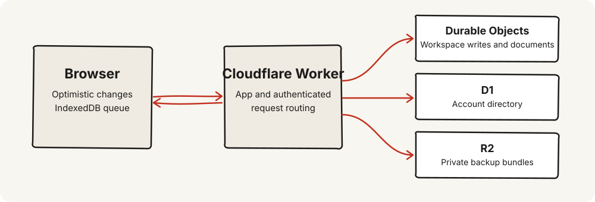

<p align="center">
  <picture>
    <source media="(prefers-color-scheme: dark)" srcset="brand/svg/lockup-reverse-on-ink.svg" />
    
  </picture>
</p>

<p align="center"><b>Collaborative issue tracking, close to your code.</b></p>

<p align="center">
  <a href="#installation"><b>Get started</b></a> ·
  <a href="#features"><b>Features</b></a> ·
  <a href="docs/architecture.md"><b>Architecture</b></a> ·
  <a href="CONTRIBUTING.md"><b>Contribute</b></a>
</p>


Kanbun is an open-source, local-first issue tracker for engineering teams. Organize work, write
and discuss issues together, and see GitHub pull requests alongside the work they support. Run a
workspace in your own Cloudflare account or explore it locally with synthetic data.

> Kanbun is in active development for an invited-team pilot. Check the
> [launch-readiness report](docs/launch-readiness.md) before choosing a release for team use.

## Installation

Choose the setup that fits what you want to do.

| Setup               | Start here                                                                                                       |
| ------------------- | ---------------------------------------------------------------------------------------------------------------- |
| Explore locally     | [Run Kanbun locally](#run-locally) with Docker or Colima and host Node.js.                                       |
| Host a workspace    | Follow the [Cloudflare installation guide](docs/cloudflare-deployment.md).                                       |
| Evaluate for a team | Review the [evaluation guide](docs/evaluation.md) and [operating responsibilities](docs/operations-overview.md). |

[](https://deploy.workers.cloudflare.com/?url=https%3A%2F%2Fgithub.com%2Fsidmohan0%2Fkanbun)

The button provisions a setup shell. Complete owner, origin, email, and Turnstile configuration
using the installation guide before signing in. An isolated-installation rehearsal is tracked in
launch readiness.

### Run locally

Install Docker or Colima on macOS, plus host Node.js to bootstrap the pinned devcontainer CLI.
From your checkout, run:

```sh
./scripts/devcontainer.sh up
./scripts/devcontainer.sh dev
```

In another terminal, print the published address:

```sh
./scripts/devcontainer.sh url
```

Open the address and choose **Initialize local workspace**. Local mode uses synthetic Alice and
Bob identities. Create an issue, change its properties, open its description, and try the board.
Use this mode on localhost with synthetic data. Stop the checkout's containers with
`./scripts/devcontainer.sh stop`.

See the [local guide](docs/local-worker.md) for persistence, troubleshooting, and reset procedures.
For a hosted workspace, configure a custom origin, email delivery, Turnstile, storage, and owner
identity. Add an installer-owned GitHub App when your team needs repository context.

## Features

- **Issues and relationships**: Track status, priority, assignees, labels, sub-issues, and dependencies.
  Archive issues and undo the action when needed.
- **Views**: Browse lists and boards, find your assigned work, and narrow results with search,
  filters, and sorting.
- **Collaborative work**: Edit descriptions together, discuss issues, and keep up through a personal
  notification inbox.
- **Local-first editing**: Make optimistic changes, queue pending work in the browser, and sync
  across sessions when connected.
- **GitHub context**: See pull requests, reviews, branches, and CI from selected repositories next
  to related issues. People control issue status.
- **Workspace administration**: Invite eligible people, manage members and teams, configure
  workflows, and create private backup bundles for restoration.

## Current boundaries

Kanbun is growing toward a broader collaborative workflow. Here's where things stand today:

| Area                          | Available today                                                                                                   | Planned or limited                                                                            |
| ----------------------------- | ----------------------------------------------------------------------------------------------------------------- | --------------------------------------------------------------------------------------------- |
| Offline work                  | An open, authorized page can queue edits.                                                                         | Hosted cold starts and reloads require connectivity and authentication.                       |
| Hosting                       | Cloudflare Workers, SQLite Durable Objects, D1, and R2. Local development uses workerd in the devcontainer.       | Review the [installation guide](docs/cloudflare-deployment.md) before hosting a real backlog. |
| Access                        | An owner initializes a workspace and invites people within the configured email domain.                           | See [team readiness](docs/team-readiness.md) for qualification evidence.                      |
| GitHub                        | Selected repositories provide read-only development context.                                                      | Provider evidence does not automatically change issue status.                                 |
| Workspace branches and agents | APIs support isolated issue changes and merge receipts; the engine includes agent scopes and branch ownership.    | Branch review and a complete agent execution workflow are planned.                            |
| Events and portability        | Supported issue and discussion commands record semantic events; recovery bundles restore compatible Kanbun state. | Some mutations use a legacy patch path. General backlog import and export are planned.        |

External notification delivery and time-travel views are also planned. The [specification](SPEC.md)
describes the longer-term design and identifies implementation status.

## How Kanbun works



A Worker serves the React application and routes authenticated requests. A SQLite-backed Durable
Object serializes each workspace's writes, while Document Durable Objects merge collaborative
descriptions with Yjs. D1 stores the account directory and R2 holds private backup bundles.

The browser applies optimistic commands, stores pending work in IndexedDB, and reconciles it with
HTTP responses. WebSocket notifications prompt clients to pull committed changes. Explore the
[architecture overview](docs/architecture.md), [engineering case study](docs/case-study.md), and
[event replay guide](docs/event-replay.md).

## Development

The [devcontainer](.devcontainer/devcontainer.json) is the shared environment for development and
repository-owned CI. It pins Linux, Node.js, pnpm, and browser dependencies. VS Code Dev Containers
and GitHub Codespaces use the same configuration.

```sh
./scripts/devcontainer.sh up
./scripts/devcontainer.sh exec pnpm install --frozen-lockfile
./scripts/devcontainer.sh verify
```

Run repository commands with `./scripts/devcontainer.sh exec <command...>`. Rebuild with
`./scripts/devcontainer.sh rebuild` after changing the container image or browser dependencies.
Keep dependencies in their owning workspace manifest and commit the root `pnpm-lock.yaml` with
manifest changes.

The verifier covers formatting, lint, typechecking, tests, builds, seed smoke checks, browser
recovery scenarios, spec/archive checks, and mechanical documentation checks. Changelog and
history-aware spec-lock checks are separate required checks. See [verification](docs/verification.md)
and [contribution guidance](CONTRIBUTING.md).

To capture UI screens while the local stack runs:

```sh
./scripts/devcontainer.sh exec pnpm --filter @kanbun/verifier capture:ui
./scripts/devcontainer.sh exec pnpm --filter @kanbun/verifier capture:hosted
```

Screenshots are saved in `output/ui-capture`; set `KANBUN_CAPTURE_DIR` to change the destination.
Issue detail captures require an existing local issue. Hosted-only screens use a disposable local
Worker and fixture accounts, without accessing hosted data.

### Packages

<!-- workspace-inventory:start -->

- `apps/desktop`
- `apps/web`
- `apps/worker`
- `packages/events`
- `packages/model`
- `packages/mutators`
- `packages/seed`
- `packages/sync`
- `packages/verifier`

<!-- workspace-inventory:end -->

The [desktop shell](docs/desktop.md) provides a Kanbun-logo tray and a local, read-only agent session prototype.

## Contributing and support

Report a bug or request a feature through [GitHub issues](https://github.com/sidmohan0/kanbun/issues/new/choose).
Read the [contribution guide](CONTRIBUTING.md) before opening a pull request, and use the
[security policy](SECURITY.md) to report vulnerabilities privately.

Need help deploying Kanbun, configuring authentication and GitHub, verifying backups, or preparing
your team to operate it? Email [sid@datafog.ai](mailto:sid@datafog.ai). The
[implementation-help guide](SUPPORT.md#paid-implementation-help) explains the paid service and
handover. Ongoing maintenance and custom work are scoped separately.

## License

Built by [Sid Mohan](https://github.com/sidmohan0). Copyright 2026 Sid Mohan. Kanbun is licensed
under the [Apache License, Version 2.0](LICENSE). See [third-party notices](THIRD_PARTY_NOTICES.md)
and the [brand kit](brand/KIT.txt).
