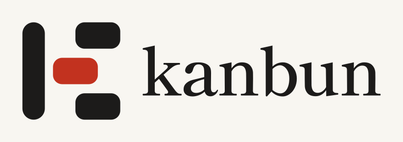
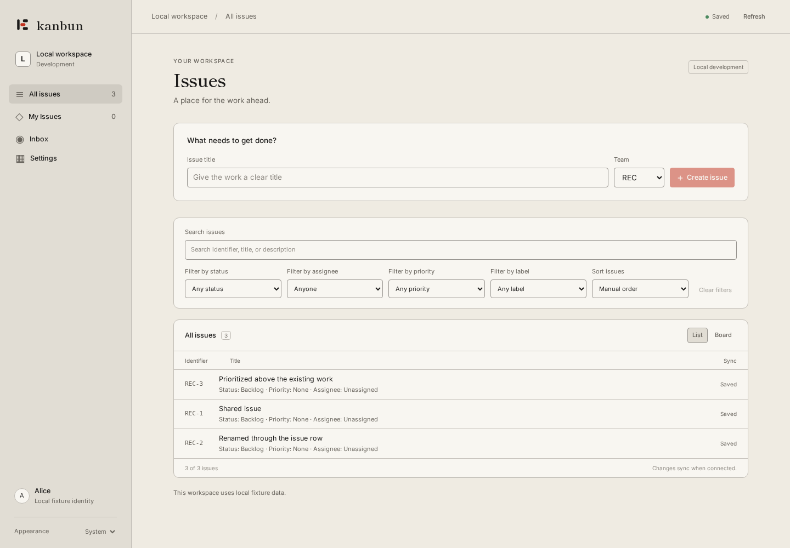

<picture>
  <source media="(prefers-color-scheme: dark)" srcset="brand/svg/lockup-reverse-on-ink.svg" />
  
</picture>

# kanbun

A local-first issue tracker with collaborative editing and GitHub context.

Kanbun helps engineering teams organize issues, discuss work, and review linked pull requests.
The application runs in your Cloudflare account. Developers can evaluate it locally with the
repository's Docker-based devcontainer.

[Run locally](#run-locally) · [Deploy to Cloudflare](docs/cloudflare-deployment.md) ·
[Evaluate for your team](docs/evaluation.md) · [Implementation help](#implementation-help)

[](https://deploy.workers.cloudflare.com/?url=https%3A%2F%2Fgithub.com%2Fsidmohan0%2Fkanbun)

The button provisions a setup shell. Complete owner, origin, email, and Turnstile configuration
using the [installation guide](docs/cloudflare-deployment.md) before signing in. An isolated-installation
rehearsal is tracked in launch readiness.



## What works today

- Issues with status, priority, assignment, labels, archive and Undo, sub-issues, and dependencies.
- List and board views, My Issues, search, filters, and sorting.
- Collaborative descriptions, attributed discussion, and a personal notification inbox.
- Optimistic edits, persisted browser queues, and automatic synchronization across sessions.
- Email-link sign-in, targeted invitations, membership administration, teams, and workflow settings.
- GitHub pull request, review, branch, and CI context from selected repositories.
- Private workspace backup bundles and isolated restoration.

Kanbun is in active development for an invited-team pilot. Review the
[launch-readiness report](docs/launch-readiness.md) before choosing a release for team use.
The [team-readiness record](docs/team-readiness.md) links existing product tests and historical
qualification evidence. Each release candidate needs its own verification.

## Current boundaries

| Area               | Current scope                                                                                                                                          |
| ------------------ | ------------------------------------------------------------------------------------------------------------------------------------------------------ |
| Offline work       | An already open, authorized page can queue edits. Hosted cold starts and reloads require connectivity and authentication before reopening cached work. |
| Hosting            | Cloudflare Workers, SQLite Durable Objects, D1, and R2. Local workerd runs inside the devcontainer for development and evaluation.                     |
| Access             | An owner initializes a workspace and invites eligible people within the configured email domain.                                                       |
| GitHub             | Selected repositories supply read-only development context. People control issue status.                                                               |
| Workspace branches | APIs support isolated issue creation, title changes, conflict choices, and durable merge receipts. A branch-review interface is planned.               |
| Agents             | The engine includes agent scopes and branch ownership. A complete agent execution and review workflow is planned.                                      |
| Events             | Supported issue and discussion commands record semantic events. Some mutations retain the legacy patch path.                                           |
| Data portability   | Recovery bundles restore compatible Kanbun state. General-purpose backlog import and export are planned.                                               |

External notification delivery, autonomous agent runs, derived status from provider evidence, and
time-travel views are planned. The [specification](SPEC.md) describes the longer-term design;
its implementation-status section identifies the current scope.

## Run locally

Install Docker, or Colima on macOS, and host Node.js to bootstrap the pinned devcontainer CLI.
Run these commands from the checkout:

```sh
./scripts/devcontainer.sh up
./scripts/devcontainer.sh dev
```

In another terminal, print the published address:

```sh
./scripts/devcontainer.sh url
```

Open that address and choose **Initialize local workspace**. Local mode uses synthetic Alice and
Bob identities. Create an issue, change its properties, open its description, and try the board.
Use this mode on localhost with synthetic data.

Stop this checkout's containers with `./scripts/devcontainer.sh stop`. The
[local guide](docs/local-worker.md) explains persistence, initialization, troubleshooting, and
reset procedures. Docker provides the local development environment; ongoing team hosting uses
the authenticated Cloudflare installation.

## Deploy to Cloudflare

Follow the [Cloudflare installation guide](docs/cloudflare-deployment.md) to configure a workspace
in your account. Setup includes a custom origin, email delivery, Turnstile, storage, and owner
identity. Configure an installer-owned GitHub App separately when your team needs repository
context.

Review [operating responsibilities](docs/operations-overview.md), required provider services, data
recovery, and upgrade limits before putting a real backlog into the installation. The existing
maintainer preview has its own [operations runbook](docs/operations.md).

## Development

The [devcontainer](.devcontainer/devcontainer.json) is the standard environment for local work and
repository-owned CI. It pins the Linux image, Node.js, pnpm, and browser dependencies. VS Code
Dev Containers and GitHub Codespaces use the same configuration.

```sh
./scripts/devcontainer.sh up
./scripts/devcontainer.sh verify
./scripts/devcontainer.sh exec pnpm install --frozen-lockfile
```

Run repository commands with `./scripts/devcontainer.sh exec <command...>`. After changing the
container image or browser dependency, run `./scripts/devcontainer.sh rebuild`. Keep each
workspace's dependencies in its own manifest and commit the root `pnpm-lock.yaml` with dependency
changes.

The complete verifier runs formatting, lint, typechecking, tests, builds, seed smoke checks,
browser recovery scenarios, spec/archive checks, and mechanical documentation checks. Changelog
and history-aware spec-lock checks are separate required checks. See
[verification](docs/verification.md) and [contribution guidance](CONTRIBUTING.md).

## Architecture

A Worker serves the React application and routes authenticated requests. Each workspace has a
SQLite-backed Durable Object that serializes writes, while separate Document Durable Objects
merge collaborative descriptions with Yjs. D1 stores the account directory. R2 holds private
backup bundles.

The client applies optimistic commands, persists pending work in IndexedDB, and reconciles it with
authoritative HTTP responses. WebSocket notifications prompt clients to pull committed changes.
Read the [architecture overview](docs/architecture.md),
[engineering case study](docs/case-study.md), and [event replay guide](docs/event-replay.md).

Current workspace packages:

<!-- workspace-inventory:start -->

- `apps/web`
- `apps/worker`
- `packages/events`
- `packages/model`
- `packages/mutators`
- `packages/seed`
- `packages/sync`
- `packages/verifier`

<!-- workspace-inventory:end -->

## Implementation help

I offer paid help deploying Kanbun in your Cloudflare account, configuring authentication and
GitHub integration, verifying backups, and preparing your team to operate it.

Email [sid@datafog.ai](mailto:sid@datafog.ai) with your team size, current tools, and setup
requirements. The [implementation-help guide](SUPPORT.md#paid-implementation-help) explains the
scope, customer prerequisites, and handover deliverables. Ongoing maintenance and custom work are
scoped separately.

Built by [Sid Mohan](https://github.com/sidmohan0). [Report a bug](https://github.com/sidmohan0/kanbun/issues/new/choose),
read the [support policy](SUPPORT.md), or report vulnerabilities privately using the
[security policy](SECURITY.md).

## License and assets

Copyright 2026 Sid Mohan. Licensed under the [Apache License, Version 2.0](LICENSE).
[Third-party notices](THIRD_PARTY_NOTICES.md) describe external components and font references.
The [brand kit](brand/KIT.txt) documents the original logo assets and usage guidelines.
