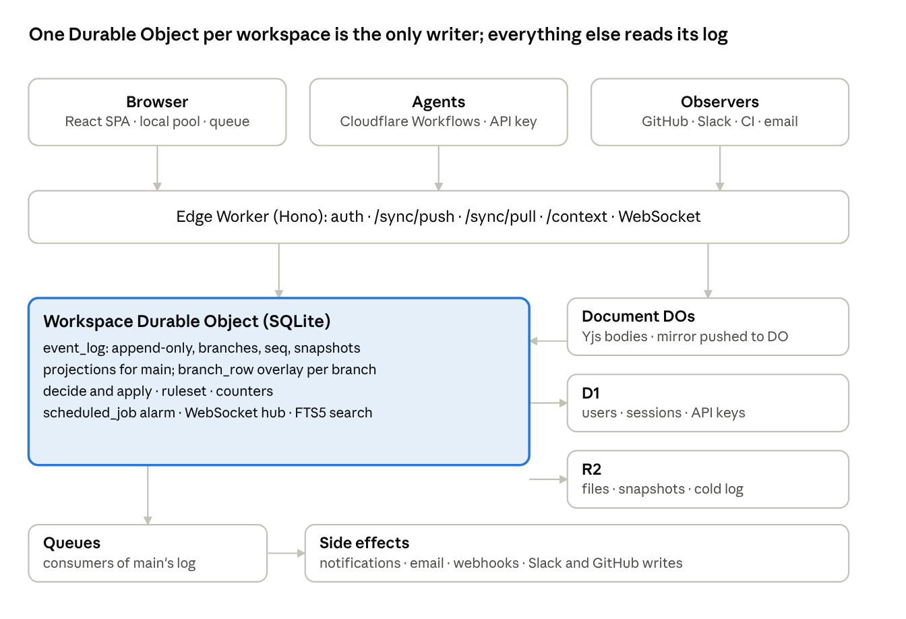
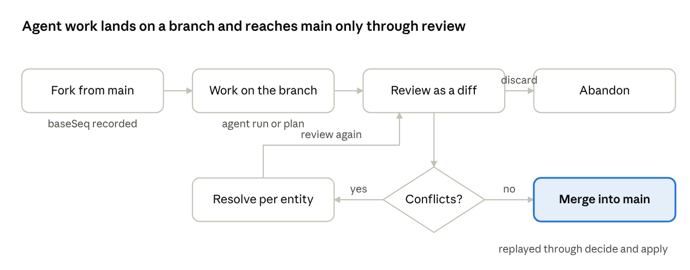
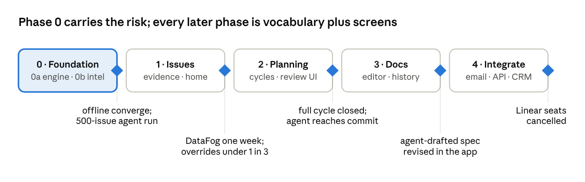

# kanbun — data model & architecture spec v1.1

> **Archived copy** of version 1.1, current on 31 Oct 2026. Figures: [`figures/`](figures/).

## Implementation boundary

This specification includes design commitments that are still planned. The current application supports issue management, collaborative descriptions, discussion, invitations and membership, teams and workflow statuses, and read-only GitHub context. An open authorized page can retain offline edits; hosted cold starts require connectivity and fresh authentication before reopening cached work.

Semantic events cover supported issue and discussion commands; other mutations retain a legacy patch path. The log does not yet reconstruct the entire workspace. Durable workspace branches support issue creation and title changes, human conflict choices, and retry-safe merge through APIs. The branch-review UI is planned.

Agent scopes and ownership are enforced by the engine. Autonomous agent execution, earned autonomy, evidence-derived status, time-aware views, wider planning surfaces, general-purpose import/export, and external notifications remain planned. Workflows, Queues, and Email Workers in the architecture below describe intended components. The current sign-in implementation uses a provider HTTPS email API.

The local devcontainer supplies workerd-based development and evaluation with synthetic identities. Team hosting requires authenticated Cloudflare deployment. A complete local test run establishes its documented runtime scope; account provisioning, DNS, email delivery, and production upgrades require separate installation evidence.

## Thesis

kanbun is a ledger of evidence and decisions about a team's work, with branches; the issue tracker is a view of that ledger. A conventional tracker is a place where humans type the state of the work. kanbun computes the state from evidence and lets humans and agents correct it. Everything below follows from five commitments.

1. **Events, not patches.** The log stores a closed vocabulary of semantic events (`IssueStarted`, `PRMergedFor`, `HumanAssertedStatus`), each with a schema and a reducer. That one vocabulary is the mutation API, the agent tool list, the activity feed, the webhook payload and the test fixture. Patches are derived from events, never the reverse.
2. **Status is derived from evidence.** GitHub, CI, Slack, calendars and agents are observers that emit `Observed*` events. A human saying "done" is also an event, and it outranks machine observation by rule. A versioned ruleset turns ranked evidence into status, progress and risk, with a visible "why" on every value.
3. **Branches, not proposals.** The workspace log forks like git. Every agent run gets a branch; a human reviews it as a diff of the workspace and merges or discards. Plans ("what if we cut project X") are branches too.
4. **Trust is earned and stored in the log.** Each agent's autonomy per event class (observe, propose, commit) is computed from its merge and revert history. The policy that computes it is itself an event.
5. **Time is a dimension of every screen.** Because state is a projection of an ordered log, "as of" and "since" are free. The home screen is the diff since you last looked, not a list of issues.

Foundations: one Durable Object per workspace as the single writer, the Replicache-shaped sync loop, fractional indexing, Yjs for rich text, the Cloudflare stack, and entity names kept compatible with existing trackers' public APIs so a future import maps 1:1.

## Scope and rules

The UI scope is the working surface of a modern issue tracker: issues, teams, cycles, projects, milestones, initiatives, documents, views, inbox, search, settings, integrations and customers. What is different sits underneath it, and a few flows the log makes redundant are dropped by design: per-category notification settings (subscriptions over the log replace them), proposal and approval surfaces (branches replace them), and a separate status-update feed (it becomes the home screen). GitHub moves into phase 1 because derivation needs its observations.

Deferred: onboarding polish, project-update schedules, sidebar customization, document subscribers, data export.

| Rule | Detail |
| --- | --- |
| Original application work | Product-specific code, illustrations, icons, logos, wordmarks and styles are original. Licensed foundational dependencies, fonts and official provider assets require source and license attribution. Do not copy another product's source, proprietary assets, or captured traffic. |
| Schema is a re-expression | Entity and field names are kept compatible with the public APIs of existing trackers so an import maps 1:1. The event vocabulary and derivation rules are kanbun's own. |
| One name | Product name kanbun, repo [github.com/sidmohan0/kanbun](https://github.com/sidmohan0/kanbun), workspace URL `kanbun.<domain>/<workspace>`. |

## Architecture on Cloudflare

Each workspace is one Durable Object with its own SQLite database. That object is the single writer, the branch-aware log, the ruleset runner and the WebSocket hub. Everything else is a satellite of it. Two components are specific to this design: Workflows for agent runs and observers for inbound evidence.



Clients never talk to the DO directly; the Worker routes every read and write, and side effects only ever consume the log.

| Component | Role | Why this choice |
| --- | --- | --- |
| Workspace Durable Object (SQLite) | Authoritative store for every entity, the append-only `event_log` with branches and change capture, materialized projections for main, a `branch_row` overlay table for branches, the derivation ruleset, push/pull/poke, WebSocket hibernation, a `scheduled_job` table driving one alarm | Single writer per workspace gives a total order for free. DO SQLite's 10 GB is far beyond one company's tracker once snapshots live in R2 |
| Document Durable Objects | One per issue, project, initiative or document body: Yjs state, presence, inline-comment anchors. Pushes a debounced plain-text mirror to the workspace DO as a system-actor event | Collaborative rich text needs CRDT merge. Keeps editor traffic out of the workspace DO |
| Edge Worker (Hono) | Session auth, `/sync/push`, `/sync/pull`, `/context`, WebSocket upgrade, signed R2 URLs, REST for API keys, inbound webhooks from observers | Stateless, scales to zero, fronts everything |
| Workflows | Durable execution for agent runs: each step emits `AgentActivity` events through `/sync/push` on the run's branch; suspends for human input | Crash-safe, resumable, already in the stack; no Temporal or Restate dependency |
| Observers | GitHub App first; Slack app, CI webhooks, Email Workers and calendar later. Each translates an external fact into an `Observed*` event with a `sourceRef` | Derived status needs evidence from where work actually happens |
| D1 | Users, organizations, memberships, sessions, invites, API keys, delegated tokens, workspace directory | Cross-workspace lookups (login, invites) must not depend on one DO |
| R2 | Attachments, images, avatars, log snapshots (every 10k seq or weekly), Yjs history snapshots, compacted originals, cold agent reasoning after 30 days | S3-compatible, no egress fees |
| Queues | Log consumers: notification fan-out, email digests, outbound webhooks, Slack and GitHub writes, embedding jobs later | Side effects are consumers of the log, never part of the write path |
| Search | SQLite FTS5 tables inside the workspace DO | One company's data fits; no separate index to keep in sync |
| Static assets | React SPA on Workers Static Assets | Same deploy, same domain, no CORS |

Not used: Workers AI and Vectorize (embeddings are a later Queue consumer keyed by entity id and `updatedAt`, no schema change), Hyperdrive or Postgres, KV.

## The log

The `event_log` table in the workspace DO is the only truth. Every table a screen reads is a projection of it and can be rebuilt from a snapshot plus the tail.

| Column | Type | Meaning |
| --- | --- | --- |
| `seq` | integer | Monotonic per workspace, across all branches. Assigned only by the DO |
| `branchId` | UUIDv7 | `main` or a branch id. Events on a branch are invisible to main until merged |
| `txnId` | UUIDv7 | One mutator call; all events it emitted share it. Unit of undo and of activity grouping |
| `type` | text | One of the closed vocabulary (next section) |
| `entityType`, `entityId` | text, UUIDv7 | The primary subject |
| `teamId`, `scopeUserId` | UUIDv7, nullable | Denormalized from the entity at commit so private-team and per-user pull filtering is a column predicate, not a join |
| `payload` | JSON | Validated against the event type's Zod schema |
| `actor` | JSON | `{ id, type, via? }`. `type` is `user`, `agent`, `observer` or `system`. `via` names the tool a user acted through (`claude-code`, `cursor`, `mcp`, `web`) so a personal agent's writes are the user's, with the tool recorded |
| `sessionId` | UUIDv7 | The `AgentSession` that produced it, when `actor.type = agent` or `via` is an agent tool |
| `causationSeq` | integer | The event that triggered this one (an `AgentActivity`, an `Observed*`, a merge) |
| `sourceRef` | text | External identity for observations: `github:pr:1234`, `slack:msg:…` |
| `clientId`, `mutationId` | text, integer | Idempotency: a retry of the same pair is a no-op |
| `ts` | integer | DO wall clock at commit. Never used for ordering |

**Invariants**

- Append-only. No row is updated or deleted; corrections are new events. The only exception is trash purge, which emits `EntityPurged` and nulls the payloads of that entity's earlier rows.
- Every projection row carries `id` (UUIDv7, client-generated), `createdAt`, `updatedAt` and `archivedAt` for display and sorting, and `createdSeq`, `updatedSeq` for correctness. Timestamps are denormalized from the event's `ts` at apply, so no list or "2h ago" needs a log lookup.
- Every apply records which projection fields it changed and their previous values (change capture). Events are the truth; a patch with `prev` is a by-product of every event, which is what webhooks, non-reducing consumers, the activity feed and undo consume, and what pull ships beside events for derived columns.
- Per-team counters (`Issue.number`, cycle numbers) are assigned only inside the DO on main. A branch shows a placeholder until merge.
- Many-to-many links are their own rows, mutated by add and remove events, never by replacing an array.
- Ordering fields are fractional-index strings.
- Rich text lives in a Document DO; the log carries only `DocumentMirrorUpdated` with the plain text and a `contentState` hash.

**Snapshots and bootstrap.** Every 10,000 seq on main, or weekly if that comes first, the DO writes a snapshot of all projection tables to R2 and records `SnapshotTaken(seq)`. The time floor keeps low-activity workspaces' replays short. A client bootstraps from the latest snapshot plus the tail. A branch is an overlay on live main (see Branches) and needs no snapshot of its own.

**Retention** is stated up front and enforced by an alarm job.

| Class of event | Kept | Where |
| --- | --- | --- |
| Human assertions, decisions, merges, ruleset and policy changes | Forever | DO |
| Data events from agents and observers | Forever, but compacted after 90 days into `SummaryOf(range)` events; originals move to R2 | DO summary, R2 originals |
| `AgentActivity` of type `thought` | 30 days hot | R2 after, fetched on "show reasoning" |
| Abandoned branches | 30 days | Deleted; `BranchAbandoned` stays |

**As-of and diff** are queries: `projectAt(seq)` replays from the nearest snapshot; `diff(a, b, scope)` groups the events between two seqs by `txnId` and entity. Both are cheap for one workspace and are what the time controls and the home screen use. For a seq older than the compaction horizon, replay fetches the original events from R2 rather than the `SummaryOf` rows: slower, but exact, never best-effort.

## Event vocabulary

The vocabulary is closed: 75 named event types in nine groups plus a generic configuration pair per entity, about 85 in all, each with a Zod schema in `packages/events` and a reducer in `packages/mutators`. Adding a type is a schema change and a PR; nothing else in the system takes an arbitrary patch. Names use past tense for facts and `Asserted` for human claims that override evidence. The list is audited against every kept flow before the webhook contract freezes; the first draft's 62 missed milestone and initiative editing, template application, favorites and project lifecycle.

| Group | Event types | Notes |
| --- | --- | --- |
| Issue lifecycle (11) | `IssueCreated`, `IssueTitled`, `IssueDescribed`, `IssuePrioritized`, `IssueEstimated`, `IssueDueDateSet`, `IssueParented`, `IssueMovedToTeam`, `IssueArchived`, `IssueTrashed`, `IssueRestored` | Each carries only its own fields. `IssueDescribed` carries the mirror text and hash, not the body |
| Assignment and status (6) | `IssueAssigned`, `IssueUnassigned`, `IssueDelegated`, `HumanAssertedStatus`, `IssueSnoozed`, `IssueTriaged` | There is no `IssueStatusSet`. Status is derived; `HumanAssertedStatus` is the human's evidence and the strongest input, and with `stateId: null` it clears an override |
| Relations and labels (6) | `IssueRelated`, `IssueUnrelated`, `LabelAdded`, `LabelRemoved`, `SubscriberAdded`, `SubscriberRemoved` | Join-table add and remove ops |
| Planning (22) | `ProjectCreated`, `ProjectUpdated`, `ProjectArchived`, `ProjectTrashed`, `ProjectRestored`, `ProjectHealthAsserted`, `ProjectMilestoneCreated`, `ProjectMilestoneUpdated`, `ProjectMilestoneArchived`, `IssueMovedToProject`, `IssueMovedToMilestone`, `CycleCreated`, `CycleUpdated`, `CycleClosed`, `IssueMovedToCycle`, `ScopeCutFromCycle`, `InitiativeCreated`, `InitiativeUpdated`, `InitiativeStatusAsserted`, `InitiativeArchived`, `ProjectLinkedToInitiative`, `ProjectUnlinkedFromInitiative` | Milestones and initiatives are not configuration, so they get semantic events. `ScopeCutFromCycle` is distinct from a move so velocity and rollover are first-class |
| Discussion (7) | `CommentPosted`, `CommentEdited`, `CommentResolved`, `ReactionAdded`, `ReactionRemoved`, `UpdatePosted`, `DocumentMirrorUpdated` | `UpdatePosted` covers project and initiative updates with a `health` field |
| Personal (4) | `FavoriteAdded`, `FavoriteRemoved`, `TemplateApplied`, `ViewPreferencesChanged` | Per-user; synced but excluded from team feeds |
| Observations (9) | `ObservedBranchCreated`, `ObservedPROpened`, `ObservedPRReviewed`, `ObservedPRMerged`, `ObservedCIResult`, `ObservedDeploy`, `ObservedSlackMention`, `ObservedEmailReceived`, `ObservedCalendarEvent` | Always `actor.type = observer` with a `sourceRef`. Never mutate projections directly; only the ruleset reads them |
| Agents and branches (7) | `AgentSessionStarted`, `AgentActivity`, `AgentSessionEnded`, `BranchCreated`, `BranchMerged`, `BranchAbandoned`, `BranchConflictResolved` | `AgentActivity.payload.kind` is `thought`, `action`, `elicitation`, `response`, `error`, mirroring the agent-session model used by current trackers' public APIs |
| Governance and system (3) | `RulesetChanged`, `AutonomyPolicyChanged`, `AutonomyLevelChanged` | `AutonomyLevelChanged` is emitted by the policy job, so promotions and demotions are auditable |

Workspace configuration (teams, workflow states, labels, templates, views, members, integrations) is covered by one generic pair per entity, `<Entity>Upserted` and `<Entity>Archived`, which is where a plain patch is acceptable: configuration has no evidence semantics.

**What this buys.** The agent tool list is generated from the Zod schemas, so an agent calling `IssueAssigned` is validated identically to a human clicking assign. The activity feed is a render of the log by type. Webhooks ship the event as-is. A golden log of these events is the test fixture for every feature.

## Mutators: decide and apply

A mutator is two pure functions that run identically on the browser, in the workspace DO, and inside an agent Workflow. Defined once, run three times.

```typescript
// packages/mutators
type Mutator<Args> = {
  args: ZodSchema<Args>;
  // Reads state, validates, returns the events this call means. No writes, no I/O.
  decide(state: ReadState, args: Args, ctx: Ctx): Event[];
};
// packages/events — one per event type
type Reducer<E> = (state: WriteState, e: E, ctx: Ctx) => void;

type Ctx = {
  actor: { id: string; type: 'user' | 'agent' | 'observer' | 'system' };
  branchId: string;
  authoritative: boolean;   // true only in the DO
  now: number;              // DO clock when authoritative, client clock otherwise
  session?: string;         // AgentSession id when actor.type === 'agent'
  causationSeq?: number;
};
```

**Contract**

- `decide` is where authorization, invariants and business rules live. It throws a typed `Rejection`; on the client that reverts the optimistic apply, in the DO it rejects the mutation.
- `apply` (the reducers) is total and deterministic: given the same state and event it produces the same state on every runtime. No clocks, no randomness, no I/O. Derived fields that need the DO (counters, `completedAt`) are filled by the DO into the event payload before apply, so the client's second apply is identical.
- Side effects are never inside either function. Notifications, emails, Slack posts, webhooks, embeddings are Queue consumers reading the log after commit.
- Counters and identifiers are allocated in `decide` only when `ctx.authoritative && ctx.branchId === 'main'`; otherwise the payload carries `null` and the projection shows a placeholder.
- The derivation ruleset (next section) runs in the DO after apply, inside the same SQLite transaction, and emits no events; it writes derived columns only.

**Change capture.** The store records, for every event applied, the projection fields it changed and their previous values. Patches are derived at apply and never written by hand; they are what pull ships for derived columns, what webhooks carry for consumers that do not reduce events, and where `prev` comes from for the activity feed and undo.

**Determinism as the test strategy.** `packages/mutators` ships golden logs: a seeded `event_log` and the projection tables it must produce. A feature is done when replaying its golden log yields its golden projection byte for byte on the client store and on DO SQLite. The seed script (5k issues, 40 projects, 6 cycles, 300 docs) is itself a golden log.

**Tool generation.** `packages/events` exports every schema as JSON Schema. `packages/agent-sdk` turns that into the tool list an agent receives, with one tool per mutator and descriptions pulled from the same source. There is no hand-written agent API.

## Derived state

An issue's status, progress, risk and attention flag are computed by a versioned ruleset from the ranked evidence in the log. Nobody sets status; people and systems add evidence, and the strongest evidence wins. Every derived value carries `reasons[]`, the seqs that produced it, so the UI can show why.

```typescript
// packages/rules — versioned; a change emits RulesetChanged and replays derived columns
derive(issue, evidence: Event[]): {
  state: WorkflowStateId;
  progress: number;        // 0..1 from sub-issues and milestones
  risk: 'none' | 'at_risk' | 'blocked' | 'stale';
  attention: boolean;      // true when the top two evidence sources disagree
  reasons: number[];       // seqs
}
```

**Three columns, one resolver.** `Issue` stores `assertedStateId` (the last `HumanAssertedStatus`, nullable), `derivedStateId` (the ruleset's answer from observations and agent claims) and `stateId` (what the chip shows). The first ruleset resolves `stateId = assertedStateId ?? derivedStateId` with the 14-day rule below, and sets `attention` when the two disagree. The hedge at the end of this section is then a ruleset version that always resolves to `assertedStateId` and shows `derivedStateId` behind the dot: no migration, no UI change.

**Evidence ranking for `state`**, strongest first.

| Rank | Evidence | Example |
| --- | --- | --- |
| 1 | `HumanAssertedStatus` by a member of the team | Someone clicked the status chip |
| 2 | `HumanAssertedStatus` by any other member | A PM moved it from a project view |
| 3 | `ObservedPRMerged` to the default branch for a linked PR | Maps to the team's first `completed` state |
| 4 | `ObservedDeploy` of a commit that closes the issue | Same, with `completedAt` from the deploy |
| 5 | `ObservedPROpened` or `ObservedBranchCreated` linked by branch name | Maps to the first `started` state |
| 6 | `AgentActivity` of kind `response` claiming completion | Maps to `started`, never to `completed`, until a human asserts or a PR merges |
| 7 | Team defaults | `IssueCreated` lands in `defaultIssueState` or triage |

A human assertion older than a later, stronger observation still wins for 14 days; after that the observation is surfaced as `attention = true` rather than silently overriding. `IssueStateOverrideCleared` removes a human assertion so evidence takes over again.

**Other derived columns**

- `progress` on issues, milestones, projects and cycles: computed from child issues at read time in the DO, never stored on the client as truth.
- `risk`: `blocked` when a `blocks` relation points at a non-completed issue; `stale` when no event has touched the issue or its linked PRs in `Team.staleAfterDays`; `at_risk` when `dueDate` is within 3 days and the state is not `started` or later.
- `Project.health` is asserted by `ProjectHealthAsserted` or `UpdatePosted`, and flagged `attention` when more than a third of its issues are `at_risk` or `blocked`.
- SLA timestamps are computed by an alarm job from `SlaConfiguration` and the issue's first `started` evidence.

**What is asserted, not derived.** Title, description, priority, estimate, due date, assignee, labels, project, cycle, parent, relations. These have no evidence semantics; the latest event wins.

**The hedge.** If after phase 1 DataFog overrides derived status more often than it accepts it, derivation downgrades to a suggestion: `state` becomes asserted, and the ruleset's output moves to a `suggestedState` column shown as a hint. The log, branches, trust and time commitments do not depend on this section.

## Branches

A branch is a fork of the workspace log: `(baseSeq, delta events)`. It replaces the Proposal entity, `IssueDraft`, and every approval surface with one primitive engineers already understand. Every agent run gets a branch by default; humans can create them for plans.



Conflicts never auto-resolve; the reviewer picks branch or main per entity and the choice is itself an event.

**Model**

| Field | Meaning |
| --- | --- |
| `id` | UUIDv7 |
| `name` | Human label: `agent/triage-2026-10-29`, `plan/cut-auth-from-cycle-12` |
| `baseSeq` | The main seq the branch forked from |
| `ownerId`, `ownerType` | Who opened it |
| `sessionId` | The `AgentSession`, for agent branches |
| `status` | `open`, `merged`, `abandoned`, `conflicted` |
| `scope` | Optional: team or project ids the branch may touch. Enforced in `decide` |

**Storage is an overlay, not a copy.** A branch is one table: `branch_row(branchId, entityType, entityId, row JSON | tombstone)`. A read on a branch returns the overlay row if present, else live main. This is the same `OverlayStore` the client uses for pending mutations, so a client syncs a branch by stacking one more overlay, and the UI for viewing a branch is the ordinary UI with a banner. The overlay is the diff: review and conflict detection scan one table instead of comparing every projection table. Rows are dropped on merge or abandon. For an agent branch that touched 14 issues in a 5k-issue workspace, that is 14 rows.

**Review is a workspace diff.** The review screen is `diff(baseSeq, branchHead)` grouped by `txnId` and entity: "14 issues moved to cycle 13, 3 created, 2 specs edited, 1 reassigned", each expandable to the events and, for agent branches, to the `AgentActivity` that caused them. A reviewer can accept all, accept by group, or edit on the branch before merging.

**Merge.** `BranchMerged` replays the delta onto main through the normal `decide`/`apply` path with `ctx.actor` = the merger and `causationSeq` = the merge event, so authorization is re-checked at merge time and counters are allocated then. Events that fail `decide` at merge (the issue was trashed on main meanwhile) are listed as conflicts.

**Conflicts** are detected per entity: main has an event on the same entity after `baseSeq`. They are surfaced, never auto-resolved. The reviewer chooses branch, main, or edits; `BranchConflictResolved` records the choice. Rich-text bodies never conflict because Yjs merges them.

**Rules**

- A branch cannot allocate identifiers, send notifications, post to Slack or trigger webhooks. Queue consumers filter on `branchId = main`.
- A branch reads live main for anything it has not touched, so a long-lived plan branch stays current. Conflicts are per touched entity: main has an event on it after `baseSeq`. Read-set conflicts (the branch decided on main state that later changed) are not detected in this version.
- Abandoned branches are deleted after 30 days; `BranchAbandoned` stays in the log.
- Every agent's writes, workspace or personal, land on a branch unless that event class is at `commit` for that agent. A user merges their own personal agent's branch with one key.

## Agents

An agent is a client. It has an identity in the workspace, calls the same `/sync/push` and `/sync/pull` as the browser, and its tools are the mutators. There is no agent API that is not the sync API.

**Identity.** `Agent` is an entity in the workspace DO: `name`, `ownerId`, `description`, `apiKeyId` (D1), `scopes` (team and project ids), `rateBudget` (events per hour), `active`. Agents are assignable like users and appear in the member list with a distinct badge.

**Three origins, one log.** An event reaches the log in one of three ways, and the `actor` column records which.

| Origin | Identity | Permissions and trust | How it connects |
| --- | --- | --- | --- |
| Workspace agent | Its own `Agent` row | Its own autonomy ladder; workspace model keys (BYOK) | Runs on Workflows with an agent API key |
| Personal agent | The user, with `actor.via` = the tool (Claude Code, Cursor, a desktop assistant) | The user's permissions and no separate ladder: the person is responsible for what their tool does, as for what they type. Writes still land on a branch by default, so a tricked local tool cannot reach main unreviewed; the user merges their own agent's branch with one key | A delegated token from an OAuth flow with an `on_behalf_of` scope; the kanbun MCP server in `packages/agent-sdk` exposes the mutators as tools |
| Observer | An `Observer` row | Write `Observed*` events only; never mutate projections | Webhooks into the Edge Worker |

The MCP server is what makes personal agents first-class without kanbun hosting anything: a developer's local coding agent gets the same validated tool list as a workspace agent, and its writes land on a branch by default like any other agent's. The feed shows "Sid via Claude Code", and the retro can ask which tools generate reverts. Personal agents use whatever model the person already pays for; workspace agents use the workspace's keys.

**Cost.** `AgentActivity` payloads carry `tokens` and `costUsd` when known, so "what did the triage agent cost this month against how many of its branches merged" is a query from day one.

**Product principles for agents**

- Lead with "it stays true", not with agents. Agents are the mechanism; a tracker that does not rot is the pitch. The onboarding and landing page follow the thesis sentence, not the agent features.
- Agents produce evidence, not prose. An agent's useful output is an `Observed*` event or a data event on a branch; its prose sits behind a disclosure. An agent-written update is a template over the log, never a model writing paragraphs.
- Review is the new job. Inline accepts for small branches, batching by entity type, keyboard-driven accept and reject, and a daily cap on "waiting on you". Conventional trackers optimized the create-and-update loop; kanbun optimizes the review loop with the same care.
- A personal agent's actions are the person's. "My agent did that" is answered by `actor.via` technically and by this principle socially: personal agents act through the user's permissions, never a separate identity.

**Sessions and activities** follow the agent-session shape current trackers expose publicly, so the mental model transfers. `AgentSessionStarted` opens a session against an issue, project or a direct request; it creates the session's branch. `AgentActivity` events carry `kind` (`thought`, `action`, `elicitation`, `response`, `error`), a `body`, an optional `ephemeral` flag for replaceable progress lines, and for `action` the `txnId` of the data events it produced. `AgentSessionEnded` carries `outcome` (`merged`, `abandoned`, `awaiting_review`, `failed`). An `elicitation` suspends the Workflow until a human replies with a comment on the session.

**Autonomy levels** are per agent per event class and are derived, not configured.

| Level | What the agent may do | How it is earned |
| --- | --- | --- |
| `observe` | Read; emit `AgentActivity` only | Default for a new agent |
| `propose` | Write any event in scope to its branch | Default for every event class once the owner enables the agent |
| `commit` | Write that event class directly to main | 50 merged branches containing that class, zero reverts within 48 h, over at least 14 days |

A revert of an agent-committed event (a human event on the same entity and field within 48 h) demotes that class to `propose` and emits `AutonomyLevelChanged` with the reason. The policy thresholds live in `AutonomyPolicyChanged` events, so an admin can tighten them and the history shows when. The job that computes levels runs nightly on the DO alarm.

**Runtime.** Agent runs execute on Cloudflare Workflows. Each step is a durable checkpoint; a step that produces data events pushes them through the Edge Worker with the agent's API key and `branchId` = the session's branch. A crashed run resumes at its last step and its idempotency keys make the resumed push a no-op. The `/context` endpoint (next sections) is how a run loads what it needs.

**Budgets and limits.** `rateBudget` is enforced in `decide` on the DO. A session is capped at 2,000 events and 24 hours wall time; beyond either it ends with `failed` and the branch is left open for review. Agent `thought` activities are not synced to browsers by default; the UI fetches them on "show reasoning".

**What agents cannot do** regardless of level: allocate identifiers, merge their own branch, change autonomy policy, create or modify other agents, or write to a Document DO (they edit rich text by emitting `IssueDescribed` with a full replacement body, which the Document DO applies as one Yjs transaction attributed to the agent).

**Security posture.** Agents read content written by anyone, including customers via email intake, so prompt injection is a design assumption, not an edge case. The branch is the sandbox: propose-by-default for workspace and personal agents alike, `scope` enforced in `decide`, and review as a diff bound the blast radius of a tricked agent to one reviewable change. An agent that is reverted is demoted by the autonomy job. Destructive and prose-writing event classes are never eligible for `commit` and always require a human merge: `IssueTrashed`, `EntityPurged`, every `*Archived`, membership and integration changes, `AutonomyPolicyChanged`, and `IssueDescribed`, the one event where an agent writes into a collaborative body. All content an agent reads is data, never instruction, and the `/context` endpoint labels external-origin text (email, Slack) with its source so the agent SDK can wrap it.

## Sync engine

The loop is the Replicache pattern with events in place of patches and a branch on every cursor. The client store is hand-rolled on Drizzle + IndexedDB, borrowing Replicache's protocol; the DO side is Drizzle + DO SQLite. Replicache (MIT) is the reference, not a dependency.

**Lifecycle of one mutation**, e.g. `issueAssign({ id, assigneeId })`:

1. The client runs `decide` against its local projection, applies the resulting events to its pool, re-renders, and appends `{ clientId, mutationId, name, args, branchId }` to the IndexedDB queue.
2. The client POSTs the queue to `/sync/push`. The Worker authenticates and forwards to the workspace DO.
3. The DO runs `decide` with `ctx.authoritative = true` in one SQLite transaction: authorization, counters, derived timestamps. It applies the events with change capture, appends them to `event_log`, runs the ruleset for touched entities, records `lastMutationId` per client, commits.
4. The DO enqueues a change notice and sends a one-byte poke over every WebSocket subscribed to that branch.
5. Each client responds with `/sync/pull?branch=<id>&since=<lastSeq>` and receives the log rows after its cursor, the change-capture patches those rows produced for projection and derived columns, and its own `lastMutationId`.
6. The client rebases: drops confirmed mutations from the queue, applies the server rows and patches, then re-runs `decide` and `apply` for any still-pending mutations on top. A pending mutation whose `decide` now rejects is dropped and surfaced as a toast.
7. Offline, steps 2 to 6 wait; the queue persists and replays on reconnect.

**Idempotency.** `lastMutationId` per `(clientId, branchId)` is a high-water mark, as in Replicache: one client's mutations are processed in order, and the client's rebase learns which pending mutations are confirmed from that one number. Agent Workflows run steps sequentially and use one `clientId` per run; an agent that wants parallel lanes gets a `clientId` per lane from the SDK, invisibly. A resumed run re-sends with the same ids and is a no-op.

**Bootstrap and partial sync**

| Model group | Policy | Rationale |
| --- | --- | --- |
| Workspace, teams, members, agents, states, labels, templates, views, cycles, projects, milestones, initiatives, customers | Full on first load | Small; needed for every screen and filter |
| Active issues with derived columns | Full on first load, from snapshot + tail | The working set; 10k issues is roughly 6 MB with derived columns |
| Archived and trashed issues, comments, reactions, attachments | On demand per issue or view, then kept | Unbounded; rarely all needed |
| Event log rows | Only the tail since the client's snapshot; history fetched per entity for the activity feed | The client needs the projection, not the whole log |
| `AgentActivity` of kind `thought` | Never synced; fetched on demand | Volume, and rarely read |
| Branches | On open, as a separate cursor | A branch is a second small sync |
| Document bodies | On open via the Document DO | CRDT state, not in the log |

The pull endpoint filters by team membership; a membership change forces that client to re-bootstrap. The pull is shaped as a list of subscriptions (`{ model, filter }`) from day one, even though phase 1 uses only the fixed set above, so query-driven partial sync is a change to the subscription list rather than to the protocol.

**Alarms.** One `scheduled_job` table (`fireAt`, `kind`, `payload`) and one alarm handler that runs everything due and re-arms for the next `fireAt`. Jobs: SLA transitions, cycle rollover, auto-archive and auto-close, update reminders, snooze wake-ups, retention compaction, snapshotting, autonomy recomputation.

**Libraries.** `fractional-indexing`, Yjs with `y-prosemirror`, TipTap, `partysocket` on the client with the raw DO Hibernation API on the server, Hono, Drizzle, TanStack Router, Zod.

## Context API and time

Because state is a projection of an ordered log, "as of" and "since" are queries, and one endpoint serves both the home screen and every agent.

**`GET /context`**

```
/context?scope=project:<id>&since=<seq>&asOf=<seq>&budget=8000&format=narrative|facts|events
```

- `scope`: workspace, team, project, cycle, initiative, issue, or `me`.
- `since`: return what changed after this seq, grouped by `txnId` and entity, with actors and causes.
- `asOf`: project the scope at this seq instead of now.
- `budget`: approximate token budget. The DO compacts: full events for the last N, `SummaryOf` events for older ranges, derived facts for the current state.
- `format`: `facts` is the current derived state as a compact JSON tree; `events` is the raw grouped log; `narrative` is `facts` plus a plain-text rendering of `since`, written by a template, not a model.

The endpoint is the primitive behind: the home screen, standup, project updates, an agent's starting context, "ask the workspace", and later the embedding job. It is authorization-filtered the same way as pull.

**Time on every screen.** Every list, board and detail view has an "as of" control (a date or a seq) and a "since" control. Both are client-side when the needed events are already in the pool, and fall back to `/context?asOf` otherwise. A view at a past seq is read-only and banded.

**The home screen** is the landing page, not a replacement. Inbox and My Issues stay in the sidebar as the simple filters they are, and Home earns the default by passing the phase-1 gate. It is `/context?scope=me&since=<lastSeenSeq>&format=narrative`, rendered as three groups:

1. Waiting on you: open branches you can merge, elicitations addressed to you, issues with `attention = true` that you own.
2. What changed: the diff since you last looked, grouped by project, with agent and human actors shown alike.
3. Agents now: running sessions, their last `ephemeral` activity, their branch size.

A notification is a subscription over the log with a filter (`{ scope, eventTypes, actors }`), stored as `NotificationSubscription` rows. The usual grid of per-category preferences collapses into that one shape plus a per-channel delivery choice. The settings page still offers the handful of one-click toggles people reach for in week one (reactions, mentions, assignments); each writes a filter.

**Standup and updates.** Standup is `/context?scope=team:<id>&since=<yesterdaySeq>`. A project update is drafted by an agent from `/context?scope=project:<id>&since=<lastUpdateSeq>` on its branch, and `UpdatePosted` is emitted when the lead merges it.

**Compaction into narrative.** The retention job writes `SummaryOf(range)` events with a template-generated summary: counts by event type, entities touched, actors, and the asserted outcomes. Model-written summaries are a later Queue consumer that can replace a template summary, recorded as a new `SummaryOf` with `causationSeq` pointing at the old one.

## UI and UX implications

The log changes what the UI means more than what it looks like. The familiar chrome stays: the density, keyboard-first navigation, list, board and detail views, Cmd+K, the status chip. Provenance, time and branches are reachable in one gesture and never ambient; a new user should be able to use kanbun like any tracker for a week before noticing any of them.

**Three principles**

1. Same chips, deeper chips. A chip is a claim with provenance, visually identical to today's value. Overriding is the same click; it just becomes a visible assertion in the feed.
2. Group by intent, not by field. The activity feed shows one row per `txnId` ("Triage agent moved 14 issues to cycle 13") with a causation link, and undo reverts the whole transaction as a new event.
3. Time is a mode, not a page. Every view has a clock control that drops a read-only "as of" band and a scrubber; diff-since is the same control pointed the other way.

**The status chip**, the trust surface of the product.

| State | Looks like | Meaning |
| --- | --- | --- |
| Settled | The ordinary chip, no difference whether asserted or derived | The winning evidence is uncontested |
| Contested | The same chip with a small dot | Newer but weaker evidence contradicts the winning evidence. Nothing else triggers the dot |
| Placeholder | Dashed chip | On a branch, or before the DO confirms |

The tooltip is one line in one of three forms: "Done · from PR #412 merged · 2h ago", "In Progress · set by Sid · yesterday", "In Progress · agent triage claims done · 10m ago". An agent's claim never flips a chip; it produces a dot and a human confirms or ignores it. A merged PR against a human assertion also produces a dot, never a silent flip.

Clicking the chip opens the unchanged state picker and emits `HumanAssertedStatus`. Clicking the dot, or `Shift+S` on a focused issue, opens the "why" popover: the ranked evidence with source links and two actions, Accept (clears the override) and Keep (re-asserts). The popover fetches evidence lazily from `/context?scope=issue:<id>&format=events`; the chip itself renders from the derived `stateId`, `attention` and `topReasonSeq` columns. The dot is also a filter and a Home stack.

Not in phase 1: provenance UI on asserted fields (assignee, priority, due date), ranked evidence for progress or risk (a one-line tooltip is enough), and any visual distinction between asserted and derived settled chips.

**Override rate** is measured at the chip: a `HumanAssertedStatus` contradicting a derived value within one hour of its change is an override; a matching assertion or a popover Accept is an acceptance. The phase-1 gate (overrides under one in three) is a query over these events.

**New surfaces**

- Home as a diff: waiting on you, what changed since your cursor, agents running now. The cursor advances only when Home is opened, so a week away shows a compacted week.
- Branch review: a PR review for workspace data. A rail of groups by entity and action, each change in the entity's own compact form with before and after, a "why" link for agent branches, accept all or by group, edit in place, conflicts as a two-column pick. Small low-risk branches render as a one-line inline accept on Home instead.
- Agents as presence: in the assignee picker with a bot badge, in the member list, as an ephemeral status line on an issue. Reasoning behind a disclosure, never inline. An elicitation is an inbox item written like a colleague's question.
- Trust as a profile: the agent settings page shows autonomy per event class as earned badges with history; promotions and demotions appear in the feed.
- Observers as a source: evidence and issues from GitHub, Slack or email carry a source chip, and observer-created items no human has touched are marked unreviewed in lists.

**Risks.** Over-exposure, which the defaults above guard against, and review fatigue, which the autonomy ladder and the inline accept guard against.

**UX specs needed before phase 1:** Home, the evidence popover, the grouped activity feed, the agent session view. Branch review and the time scrubber are phase 2.

**Day-to-day flows versus a conventional tracker.** The conventional flows are a subset: the chrome stays, so nearly every familiar gesture still exists. What changes is what the gesture means underneath, and a handful of flows are replaced or new. Conventional flows are write flows, where a person goes somewhere and types the state of the world; most of kanbun's daily flows are read-and-confirm flows, where the state arrived from evidence or an agent and the person glances, accepts or corrects. Same screens, different verb, which is why review throughput matters more than create throughput.

| Moment | Conventional flow | What the log changes |
| --- | --- | --- |
| Open the app | Inbox, My Issues | Home is the diff since your cursor: what moved and what is waiting on you, at the same density |
| Triage | Triage queue, assign, prioritize | Same screen. Observer-created issues carry a source chip and "unreviewed". A triage agent has usually worked the queue on a branch; triage is accepting its diff or doing it by hand |
| Pick up work | Set status to In Progress | Usually not done by hand: creating the git branch from the issue lets the GitHub observer flip it. Setting it by hand is a `HumanAssertedStatus` and outranks the observer |
| Write the spec | Issue description | Same editor. An agent drafts on a branch; merging lands the body as one Yjs transaction attributed to the agent |
| Ship | Mark Done | The merged PR does it. A dot appears only if a human had asserted something else |
| Standup | Scroll yesterday's activity | `/context?scope=team&since=yesterday`, rendered as the grouped feed. One person reads it instead of everyone reciting |
| Review agent work | None | Branch review, the one new screen in phase 2 |
| Plan the cycle | Cycle page, drag issues | Same page with a "plan on a branch" toggle; plan branches compared side by side is new |
| Project update | Update modal | An agent drafts from the diff since the last update, on a branch; the lead edits and merges, emitting `UpdatePosted` |
| Something looks wrong | Issue history | The dot or `Shift+S`. The grouped feed replaces history |
| Notification settings | 17 category toggles | "Follow" filters over the log |

Three relationships to the conventional flows: unchanged gesture with changed semantics (most of them: the click emits an event, and sometimes the system already did it); replaced (about eight: Inbox, My Issues, Pulse, notification settings, issue history, manual status on evidence-backed issues, drafts, update authoring); new (five: Home as diff, the why popover, branch review, the agent session view, time mode).

## Data model

41 entities in 9 domains. Names and fields are kept compatible with existing trackers' public APIs so a future import maps 1:1. Every projection row carries `id`, `createdAt`, `updatedAt`, `archivedAt`, `createdSeq` and `updatedSeq`. Columns marked *derived* are written only by the ruleset in the DO and are read-only on the client; `Issue` carries `assertedStateId`, `derivedStateId` and `stateId` as described under Derived state.

**Workspace and people** (D1 unless noted): `Organization`, `User`, `UserSettings` (global part), `OrganizationInvite`, `ApiKey`, `TeamMembership`. In the DO: `WorkspaceMember` (userId, name, displayName, avatarUrl, admin, guest, active, written by a system event on membership change), `WorkspaceSettings` (notification and sidebar prefs per member), `Favorite`.

**Agents and branches** (DO): `Agent`, `AgentSession` (issue or project, branchId, status, summary, startedAt, endedAt, outcome), `AgentActivity` (session, kind, body, ephemeral, txnId), `Branch`, `AutonomyLevel` (agentId, eventClass, level, since, reasonSeq).

In D1: `DelegatedToken` (userId, workspaceId, tool, scopes, expiresAt, lastUsedAt), the credential a personal agent presents; its writes are attributed to the user with `actor.via` = `tool`.

**Issues** (DO): `Team`, `WorkflowState`, `Issue` (number, title, descriptionMirror, contentState, priority, prioritySortOrder, estimate, dueDate, sortOrder, boardOrder, subIssueSortOrder, branchName, snoozedUntilAt, trashed, SLA timestamps; *derived*: `stateId`, `progress`, `risk`, `attention`, `reasons`, `startedAt`, `completedAt`, `canceledAt`), `IssueLabel`, `IssueLabelLink` (M2M), `IssueSubscriber` (M2M), `IssueRelation`, `Comment` (body JSON, quotedText, editedAt, resolvedAt, exactly one owner by CHECK), `Reaction`, `Attachment`, `Draft`, `Template`, `Cycle` (with daily history arrays; *derived*: `progress`), `SlaConfiguration`, `TriageResponsibility`.

**Projects and milestones** (DO): `Project` (*derived*: `progress`, `scope`, `attention`), `ProjectStatus`, `ProjectMilestone` (*derived*: `progress`, `status`), `ProjectUpdate`, `ProjectRelation`, `ProjectLabel`, `ProjectLabelLink`, `ProjectMember`, `ProjectTeam`, `EntityExternalLink`, `IntegrationsSettings`.

**Initiatives** (DO): `Initiative`, `InitiativeToProject`, `InitiativeUpdate`, `InitiativeRelation`, `InitiativeLabel`, `InitiativeLabelLink`.

**Documents** (Document DOs for bodies, metadata in the workspace DO): `Document`, `DocumentContent` (contentState hash and mirror; Yjs binary lives in the Document DO), `DocumentContentHistory` (snapshot pointer to R2).

**Views and search** (DO): `CustomView`, `ViewPreferences` (one JSON column, Zod-validated, grown by phase), `SearchIndex` (FTS5 virtual tables).

**Notifications** (DO): `NotificationSubscription` (subscriber, scope, eventTypes, actors, channels), `Inbox` (per-viewer projection: seq, txnId, readAt, snoozedUntilAt, groupingKey).

**Customers** (DO, phase 4): `Customer`, `CustomerNeed`, `CustomerTier`, `CustomerStatus`.

**Integrations and admin** (DO): `Integration` (service, encrypted settings, scopes), `Observer` (service, installation id, last `sourceRef` seen, enabled), `Webhook`, `EmailIntakeAddress`, `SlackChannelMapping`.

**Schema decisions.** One `Comment` table with a CHECK for exactly one owner. `WorkflowState.type` and `ProjectStatus.type` are CHECK enums. Deferred fields stay as nullable columns so the deferred flows are UI work, not migrations. `packages/model` is the only place an entity is defined; `packages/events` and `packages/mutators` are the only places a write is defined.

## Build order

Six phases, each gated on something DataFog can use. Phase 0 is split: 0a is the engine and is visibly done in weeks; 0b is the intelligence and lands piece by piece on a working tracker. Every later feature is a vocabulary entry plus screens.



Each diamond is the gate that phase must pass before the next starts; the accent marks where the technical risk sits.

| Phase | What gets built | Gate |
| --- | --- | --- |
| 0a Engine | Monorepo (`apps/web`, `apps/worker`, `packages/model`, `packages/events`, `packages/mutators`, `packages/sync`); auth (magic link, Google, GitHub) on D1; workspace DO with schema, `event_log`, change capture, `branch_row` overlay, snapshots to R2, `scheduled_job`; push/pull/poke with branch cursors; client pool + IndexedDB + mutation queue + rebase; the event vocabulary with reducers and golden-log tests; Document DOs with Yjs and TipTap; design tokens and base components; seed script | Two browsers converge after offline edits on both sides including a jointly edited description. 5k seeded issues bootstrap and render under 1 s. A branch of 500 events merges with zero conflicts. Replaying the seed golden log on client and DO yields identical projections |
| 0b Intelligence | `packages/rules` with the first ruleset and the three status columns; `/context`; GitHub observer; `packages/agent-sdk` with generated tools and the MCP server; a reference agent on Workflows | A script with an API key creates 500 issues concurrently with retries on a branch; the log is consistent and idempotent. The reference agent triages 50 seeded issues on a branch and the diff reviews cleanly. A merged PR flips a seeded issue to Done with the evidence visible |
| 1 Issues and evidence | Teams, memberships, invites, workflow states; issue create, detail, sub-issues, relations, labels, priority, estimates, assignee, due date; comments, reactions, subscriptions; activity feed from the log; derived status with the "why" panel; list and board views with filter, group, sort, display; keyboard shortcuts; Cmd+K; search; favorites; archive; Inbox and My Issues; the home screen; GitHub observer live; one triage agent at `propose` | DataFog tracks its daily work here for one full week without returning to its previous tracker. Human overrides of derived status are below one in three |
| 2 Planning and branches | Projects, milestones, updates with health, timeline view; cycles with auto-create and rollover; custom views; initiatives; templates; triage queue and responsibility; SLAs; branch review UI and merge; plan branches; autonomy policy job; time controls on every view; Slack observer | A full cycle is planned, worked and closed in the app. A project update is drafted by an agent on a branch and merged by the lead. One agent reaches `commit` for one event class |
| 3 Docs | Documents under projects, initiatives and teams; editor features; move, duplicate, rename, templates; inline comment threads; version history from R2 snapshots; create-issue-from-comment | A spec is drafted by an agent, commented on by two people, and revised from version history, all in the app |
| 4 Integrations and customers | Email intake; GitHub App write path (branch names, auto-close on merge via derivation, PR linking); Slack write path; API keys, REST, webhooks; customers, tiers, statuses, requests; email notifications | Previous tracker's seats cancelled |

The deferred flows (onboarding polish, update schedules, sidebar customization, doc subscribers, export) slot in after phase 4 or when they become annoying to lack.

**Working method.** One tracker issue per flow, labelled by phase. `packages/model` is the only place an entity is defined; `packages/events` the only place an event is defined; `packages/mutators` the only place a write is defined. A feature is done when its golden log replays identically on both runtimes. A UX spec per flow is a short markdown file written from observation before the screen.

## Decisions and open questions

Decided 29 Oct 2026.

| Decision | Answer | Consequence |
| --- | --- | --- |
| Log shape | Semantic events with reducers, not `upsert`/`delete` patches; change capture derives patches at apply | `packages/events` is a phase-0a deliverable and the agent tool surface; webhooks and undo get patches with `prev` for free |
| Status | Derived from ranked evidence; `HumanAssertedStatus` strongest; stored as `assertedStateId`, `derivedStateId`, `stateId` | First ruleset in phase 0b; the hedge is a ruleset version, not a migration |
| Branch storage | One `branch_row` overlay table; reads fall through to live main | Review and conflicts are a scan of one table; no shadow copies; plan branches stay current |
| Agent writes | Branches by default for workspace and personal agents; direct commit only at earned autonomy, never for destructive or prose-writing classes | No Proposal entity; review UI is a workspace diff; a tricked local tool cannot reach main unreviewed |
| Trust | Autonomy computed nightly from merge and revert history | Policy thresholds are events; admins tune them in the log |
| Agent runtime | Cloudflare Workflows; agents are sync clients | No Temporal or Restate; one `clientId` per run, one per parallel lane |
| Idempotency | Per-client high-water mark, as in Replicache | No receipts table; rebase unchanged |
| Timestamps | `createdAt` and `updatedAt` kept beside `createdSeq` and `updatedSeq` | Display and sort without log lookups |
| Phase 0 | Split into 0a engine and 0b intelligence | Something to look at in weeks; 0b lands on a working tracker |
| Phase 1 observers | GitHub only; Slack in phase 2 | The evidence the ruleset ranks; smaller phase 1 |
| Home | Landing page beside Inbox and My Issues, not a replacement | Home earns the default through the phase-1 gate |
| Retention versus as-of | Compaction at 90 days; replay older than that fetches originals from R2; snapshots every 10k seq or weekly | As-of is always exact, never best-effort |
| Client store | Hand-rolled on Drizzle + IndexedDB, Replicache protocol as reference | `packages/sync` is phase 0a's main deliverable |
| Framework | React + Vite + TanStack Router | cmdk, Radix, dnd-kit, TipTap off the shelf |
| Rich text | `DocumentContent` with Yjs from day one for issue, project, initiative and document bodies; comments and drafts are plain JSON | Document DOs and TipTap in phase 0a; one DO per body, none per comment |
| Name and repo | kanbun, [github.com/sidmohan0/kanbun](https://github.com/sidmohan0/kanbun) | Workspace URL `kanbun.<domain>/<workspace>` |
| Auth | Magic link + Google + GitHub | The GitHub OAuth app doubles as the observer's identity |
| First team and data | `DF`; scripted seed (5k issues, 40 projects, 6 cycles, 300 docs) as a golden log | Seed is the sync and replay fixture |
| Outbound email | Resend | Magic links, digests, intake auto-replies |
| WebSockets | Raw DO Hibernation API on the server, `partysocket` on the client | About 80 lines in the workspace DO |
| SQL | Drizzle for D1 and DO SQLite | One schema package, two drivers |
| Private teams | Phase 1, pull filtering by `teamId` on the event row | Built with the sync engine, not retrofitted |
| Partial sync | Full working set now; pull shaped as subscriptions | Query-driven sync later is a subscription-list change |

**Open questions**

- [ ] Evidence rank 3 and 4: should a merged PR map to the team's first `completed` state, or to a team-configurable "merged" state? Default is the first `completed`; confirm with the first week of DataFog use.
- [ ] The 14-day window for a human assertion to outrank later observations: keep, shorten, or make it per team?
- [ ] Autonomy thresholds (50 merges, 0 reverts, 14 days) are a guess. Revisit after the first agent reaches `commit`.
- [ ] Whether `thought` activities should be visible to all members by default or only to the session owner and admins.
- [ ] Bitemporality: no `validFrom` on facts in this version. Revisit if an agent feature needs "what was true on Monday" beyond `asOf`.
- [ ] Compaction cadence: 90 days for observer and agent data events is a starting point; measure log growth against the 10 GB DO limit after phase 1.
- [ ] Snapshot interval of 10,000 seq versus a time-based interval for low-activity workspaces.

**Keeping the door open.** The engine (events, branches, derived state, evidence ranking, earned autonomy) is domain-agnostic; the issue tracker is its first vocabulary. The same engine with a different event file is a CRM where pipeline stage is derived from evidence, or support, hiring or incident response, each about to receive agent writes with no governance model. The merged and reverted branches are also the cleanest supervision data a company has about how it wants work done. None of this is in scope before phase 4, but three decisions now cost nothing and keep it possible: no package is named `issues-*`; the event vocabulary lives in its own package with the domain as a namespace (`issues.IssueCreated`); observers emit generic `Observed*` events, never issue-specific ones.

**Sources.** Replicache ([replicache.dev](https://replicache.dev)) and the Cloudflare Durable Objects and Workflows documentation.
