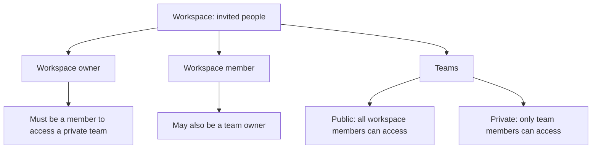

# Workspace and team permissions

This guide describes the current hosted application and its underlying mutation API. A workspace
is the admission boundary; teams organize issues and workflows inside it. A person can belong to
multiple teams. A team owner is a team-level designation, separate from workspace ownership.

Public team visibility means public **within the workspace**, not public on the internet. Private
team membership is required even for the workspace owner. Sign-in alone does not grant workspace
membership; an eligible invitee must accept their targeted invitation.

## Hosted workspace roles

The hosted directory admits the configured owner and invited users, called members in the UI.
The owner shares an invitation link; creating it does not send an invitation email.

| Action                                               | Owner                       | Member                        |
| ---------------------------------------------------- | --------------------------- | ----------------------------- |
| Enter workspace                                      | Configured owner            | After accepting an invitation |
| Invite people, revoke invitations, remove members    | Yes                         | No                            |
| Remove the workspace owner through member management | No                          | No                            |
| Rename the workspace                                 | Yes                         | No                            |
| Configure GitHub connections                         | Yes, subject to team access | No                            |
| Open workspace Settings                              | Yes                         | No                            |
| Create a team                                        | Yes                         | No                            |
| Access a public team                                 | Yes                         | Yes                           |
| Access a private team                                | Only with team membership   | Only with team membership     |
| Edit own workspace profile and settings              | Yes                         | Yes                           |
| Edit another person's workspace profile via API      | Yes                         | No                            |

Removal blocks subsequent workspace access. See [workspace member administration](ux/workspace-members.md)
for invitation and removal behavior, and [GitHub integration](github-integration.md) for repository setup.

## Team permissions

The following assumes an active workspace member and an accessible team. A team is accessible if
it is public or the person belongs to it. A workspace owner who does not belong to a private team
cannot see or administer that team. The person who creates a team becomes its first team owner.

| Action                                                                   | Workspace owner | Team owner                      | Other member |
| ------------------------------------------------------------------------ | --------------- | ------------------------------- | ------------ |
| Work with issues in an accessible team                                   | Yes             | Yes                             | Yes          |
| Archive or trash an issue, or permanently delete a trashed issue via API | Yes             | Yes                             | Yes          |
| Add and edit own comments                                                | Yes             | Yes                             | Yes          |
| Edit someone else's comment                                              | No              | No                              | No           |
| Delete someone else's comment via API                                    | Yes             | No, unless also workspace owner | No           |
| Change team settings and workflow via API                                | Yes             | Yes, for their team             | No           |
| Add a member to a private team or grant team ownership via API           | Yes             | Yes, for their team             | No           |
| Remove another person's team membership via API                          | Yes             | Yes, for their team             | No           |
| Remove own team membership via API                                       | Yes             | Yes                             | Yes          |

The API also permits an active workspace user to add an existing user to a public team without
team-admin permission, provided ownership is not being granted. Public-team membership is not
required for access. Private-team membership and agent scopes are enforced by the server.

## Interface and engine boundaries

The tables include underlying API capabilities; they do not imply that every action has a UI
control. The current Settings interface is owner-only. It creates public teams and supports team
and workflow settings, but does not provide private-team membership administration, team deletion,
or retirement. See [workspace and team settings](ux/workspace-settings.md).

The data model also defines `admin` and `guest`. The mutation engine recognizes workspace admins
for actions such as creating teams, administering accessible teams, and deleting another person's
comment. However, the hosted directory currently admits only `owner` and `user`, and invitations
create users. Neither admin nor guest is a supported hosted invitation role. The model does not
establish a complete, separately documented guest permission policy.

Agents are not team administrators. Their access inherits their owner's team visibility and is
further limited by configured agent scopes. Autonomous agent execution remains planned; see
[current product boundaries](../README.md#current-boundaries).

No role-based numeric cap on teams, members, or memberships is specified by these permissions.
Cloudflare service limits and deployment capacity still apply. A team key must be unique in the
workspace and contain 1–7 letters or digits, starting with a letter.

For the authoritative checks, see [team mutations](../packages/mutators/src/teams.ts),
[issue mutations](../packages/mutators/src/issues.ts), [comment mutations](../packages/mutators/src/comments.ts),
and [hosted directory admission](../apps/worker/src/directory.ts).
